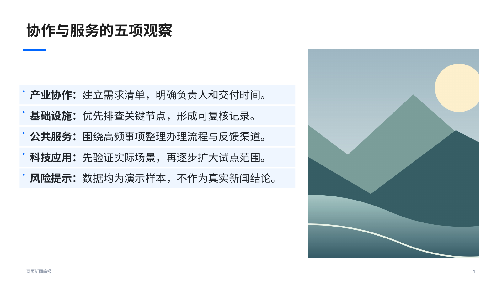
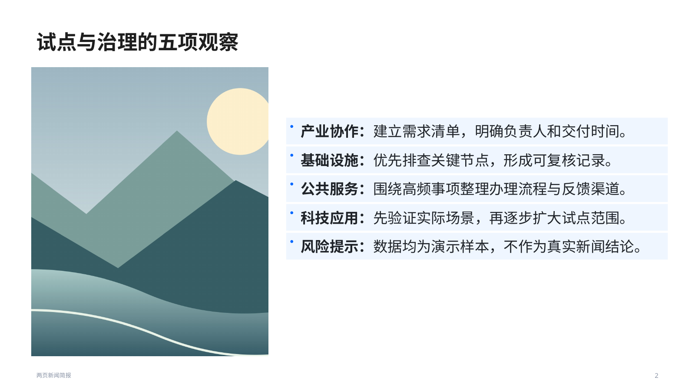
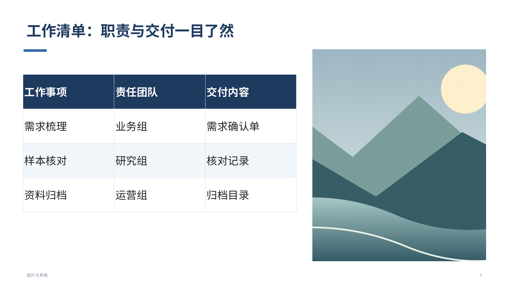
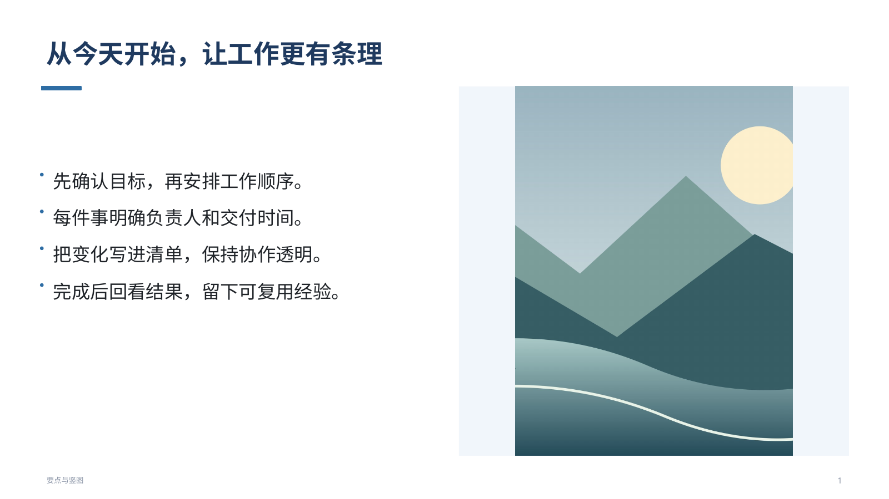
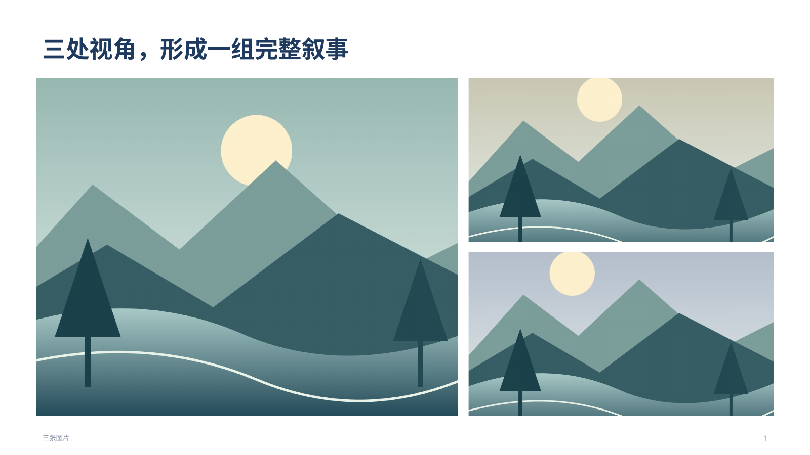
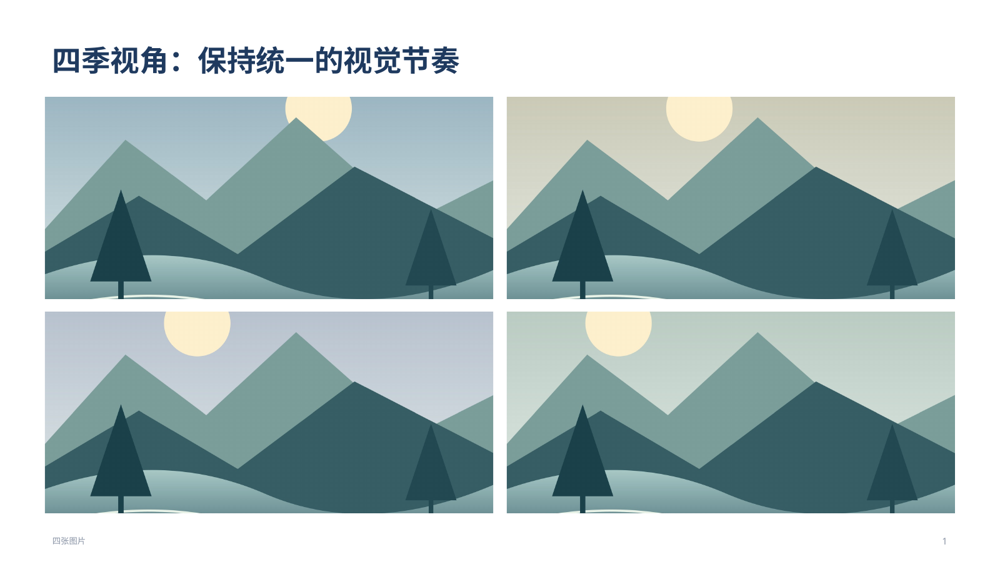
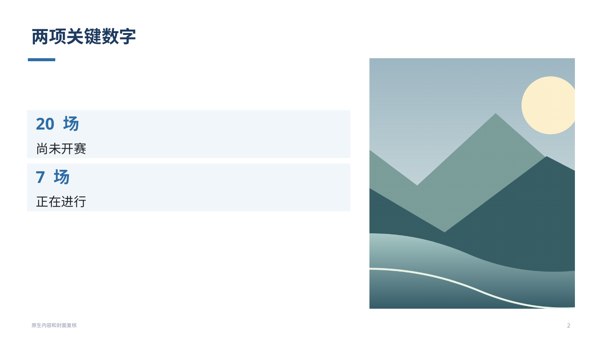
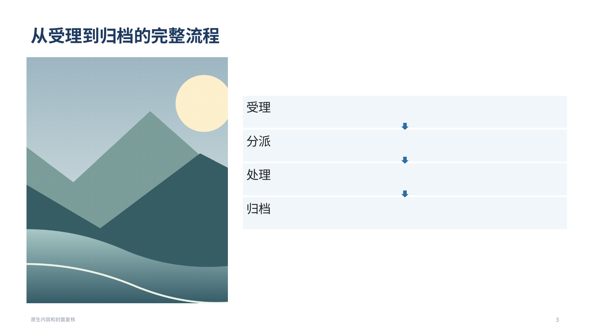
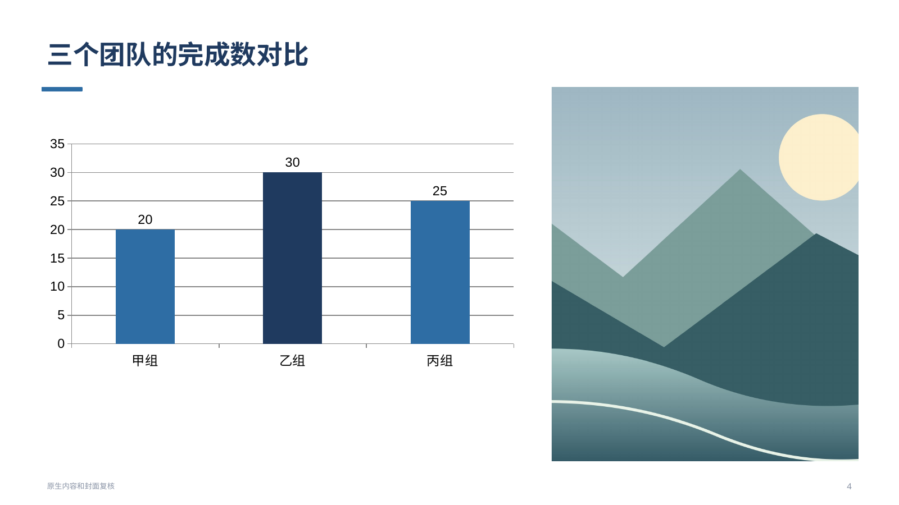

# PPT 图片美学版式执行记录（2026-11-02，北京时间）

## 基线和范围

动手前 fetch 并快进合并 `claude/jolly-darwin-tijh97` 至 `d1155ef`，已读 CLAUDE.md、代码规范、已修问题清单及本次交接；本次没有用户服务器配置、令牌或真实模型接口可用，未改正式服务。

正常制作入口启用美学规则：先定文字/图片区域及比例，再配图；已有图反向用真实宽高比决定版式。低层 `generate`/`makePptx` 的默认 legacy 仅为原始坐标接口兼容，正常工具明确传 `aesthetic`。没有按测试环境或文件名切换行为，原有窄栏坐标测试未删除、未修改。

新增三个职责模块：`pptImageLayout.js` 管纯版式/比例/裁切；`pptImageContent.js` 管真实文字区测量、分页与原生内容重排；`pptPictureRender.js` 管图片放置及封面明暗。接入原生成、配图计划和真实回执，不改 1.0.374 的含图片触发、图片路径回退和最终文件折叠。

## 真实渲染过程与修正

脚本 `jarvis/e2e/ppt-image-layout.mjs` 构造固定内容和本地 SVG 插画，栅格化为 PNG，生成6份真实PPT，逐份用 LibreOffice 转 PDF，用 pdfinfo 核对页数、读回 PDF 核对正文，再用 pdftoppm 截成1600像素宽的7张页面图。没有调用模型或图库；没有把静态几何检查称作视觉验收。

逐张查看后做了两次修正：竖图素材原来因SVG固定viewBox带内置留白，改为真实竖幅构图后重渲染；表格页原来表格偏贴顶、下方留白过多，按行数增加行高并在文字区内调整垂直位置后重看。短文横图的全幅深色遮罩让白色标题与底部正文保持清楚；竖图比例不合栏宽时保留完整图片，浅底留边不硬裁主体。

以下截图是实际 LibreOffice PDF 的页面，不是概念图。美学判断限于这些固定样例，不能证明任意模型内容都会好看。

## 六份核心样例：逐页截图与选择理由

### 01-news · 第1页：split-wide 左文右图

5条带标签要点属于结构化内容，保留约六成文字宽度，右侧竖图不再是20%窄条。标签加粗后层次清楚，文字没有碰到图片或页脚。

真实PPT读回：图片面积 25.3%；最大裁切 8.5%；内容区/表格最小字号 20 磅；未越界。

### 01-news · 第2页：split-wide 左图右文

延续同一新闻结构，换成左图右文，让连续两页有节奏变化。逐项文字完整，粗体标签和行距一致，图片与文字间距充分。

真实PPT读回：图片面积 25.3%；最大裁切 8.5%；内容区/表格最小字号 20 磅；未越界。

### 02-table · 第1页：split-wide 左文右图

表格需要横向阅读，采用split-wide，把三列原生表格放在较宽文字区。复看后增大短表行高、调整垂直位置，消除贴顶的小表和大块下方空白；表头、三行内容清楚，图片保持足够视觉分量。

真实PPT读回：图片面积 25.3%；最大裁切 8.5%；内容区/表格最小字号 20 磅；未越界。

### 03-hero · 第1页：hero

只有一句说明且图片为横幅，采用hero全幅主图加底部文字；避免横图硬塞竖栏。深色遮罩下标题与正文均清楚，标题和说明分属上下区域，未互相挤压。

真实PPT读回：图片面积 100.0%；最大裁切 0.0%；内容区/表格最小字号 20 磅；未越界。

### 04-portrait · 第1页：split 左文右图

4条要点配竖图，采用split左右分栏。直接铺满会裁切超过25%，因此完整容纳并加浅色底；两侧留边统一，四条文字易读，图像主体完整进入图片框。

真实PPT读回：图片面积 23.1%；最大裁切 0.0%；内容区/表格最小字号 20 磅；未越界。

### 05-gallery3 · 第1页：gallery-3

采用gallery-3，一大两小建立主次，左侧约六成，右侧两张统一尺寸；略调整主图区比例，确保两张小图仍超过页面面积1/8。逐张看过，间距一致、对齐完整，右侧没有挤成细条。

真实PPT读回：图片面积 65.4%；最大裁切 6.3%；未越界。

### 06-gallery4 · 第1页：gallery-4

采用gallery-4田字格，四张图片同尺寸，同主题配色；按左上、右上、左下、右下阅读。检查网格间距、对齐与标题留白，四图都有足够尺寸，裁切量均未超过25%。

真实PPT读回：图片面积 64.2%；最大裁切 20.1%；未越界。

## 补充复核：封面与原生内容

另生成一份4页演示并实际转PDF截图，自查封面、数字卡、流程箭头和图表；这些页同样未调用模型。补充脚本与产物保存在本地验收目录，核心6份样例e2e已进入发布门禁。

### 补充第1页：cover

全幅封面，按明暗加遮罩；白色标题和日期清楚，无文字互压。

### 补充第2页：split-wide

数字卡与右图分栏；20场/7场以较大数字显示，说明独立，原生文字可编辑。

### 补充第3页：split-wide

左图右文交替，流程按新文字区域纵向排原生卡片与向下箭头；四个环节顺序清楚，无交叉。

### 补充第4页：split-wide

原生柱状图与右图分栏，甲/乙/丙的20/30/25和值轴、数据标签均可读，未被图片挤压。折线图和环形图类型另有回归检查。

全量回归还发现长表补图时，默认单元格留白会让原3页增至4页。已按真实字号和单元格内边距重算，保留全部20行及原3页，`pptLiveRegression`原测试未改并通过；没有放宽字号、页数或溢出阈值。

## 质量边界与自查

- 字号：默认可在20至14磅内选择，仍放不下拆页；显式24磅按24磅测量分页，不会先按14磅测量再套回24磅。指定小于14磅与图片页约束冲突时明确报错。严格页数不能满足时保留原约束并报错。
- 图片：回执计算实际图片框并集，不重复累计重叠面积；图标、装饰、未引用媒体、外链不能冒充内容图。原有测试和阈值保留，只增加新检查。
- 原生内容：表格、文字、数字卡、流程箭头仍可编辑；适合的同单位数值表保留原生图表；不同单位、合计等复杂情况保留全部原生表格内容，不为了插图丢列或混轴。
- 缓存有界：图片缓存16MB/24项、分页最多120页、单页检查最多400图；大图不写入聊天或检查点。停止和预算信号向上传递。
- 明暗：支持的PNG逐像素检查最亮通道；无法解码使用保守深色遮罩，回执不伪称已测亮度。背景覆字是显式生成角色，普通内容图的压字检查不变。
- 未新增第三方依赖、Python运行时或静态大资源；没有修改main.js、会话/任务状态或UI功能。
- 本次为Codex自查及自动回归，尚无Claude独立审查结论；协调记录已写明接口与范围，不冒称Claude已审。

## 检查与发布

本地最终源码检查：

| 检查 | 实际结果 |
|---|---|
| npm run lint | 通过 |
| 全量 npx vitest run（NODE_USE_ENV_PROXY=1） | 339个文件、2622项全部通过，未跳过或改原测试 |
| build / build:mobile / build:standalone | 全部通过 |
| 新 ppt-image-layout e2e | 6份PPT、7页真实PDF与1600像素截图，通过 |
| 原 presentation-styles e2e | 四风格各5页真实PDF、原生图表，通过 |
| eval:check | 通过 |
| smoke | 174/174通过；WebGL原阈值保留 |
| standalone | 14/14通过，实际file://及网关转发检查 |

新增agent模块另外做过no-undef、重复键、未使用变量等检查；全部通过。源码提交 `6bd02e2`，随后单独生成并提交658文件运行时清单 `0a06d00`（均带 `[skip ci]`）；清单入口/依赖加载实测658文件通过，未请求模型。根目录本地单文件构建产物在验收后恢复，不将16MB生成HTML混入功能提交；发布工作流仍从已验收源码重新构建。

## 1.0.375发布和下载包核验

- 正式发布时间：2026-11-02 11:56:57（北京时间）；[发布页](https://github.com/xunova1121/-/releases/tag/desktop-v1.0.375)。
- 手动触发 [jarvis-desktop.yml #375](https://github.com/xunova1121/-/actions/runs/41384521555)，Windows、安卓、发布前完整验证、发布四个任务全部成功。新PPT渲染e2e与全部旧门禁均保留并通过，未修改阈值。
- 标签指向 `0a06d00371705bae272ea8e60b7382d6917c5356`，固定源码为 `6bd02e20e2d450c399d779a64a6a6974aaea0ba4`。
- 7份公开发布资产已实际下载，逐份SHA256与GitHub官方记录匹配；Windows免安装ZIP与APK的ZIP CRC通过。
- 安卓包名 `com.xunova.jarvis`，versionName `1.0.375`、versionCode `375`；APK v2签名证书与1.0.374一致。该检查不是手机真机安装验收。
- 服务器包657份运行源码的SHA256与固定清单逐项一致，清单总658份；package.json由CI生成版本号，另核实为1.0.375。三个新增版式模块确实在包内。服务器更新JSON的SHA256、Windows latest.yml的SHA512均与对应实际包匹配。
- [公开包校验记录](assets/ppt-image-layout-20261102/发布校验-1.0.375.json)。这是产物一致性检查，不代替真实模型内容或用户服务器验收。
- 未部署或重启用户正式服务；服务器模式需更新服务器代码，单装APK不会更新远端工具。

## 明确未测

未在用户服务器用真实模型制作。发版后还需实际让未央做：

1. “做成含图片的PPT，两页”。
2. “做一份6页的公司介绍PPT，每页配图”。

需核对实际版式、图片大小、裁切、每页配图回执和最终文件展示；本次本地渲染与单元测试不能代替这两项验收。未把发布安装包称为已更新用户服务器或已完成手机真机验收。
