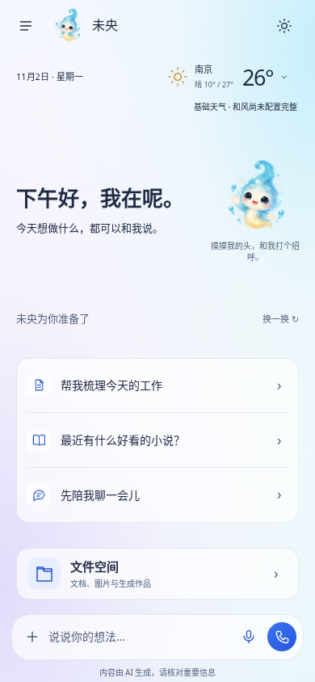
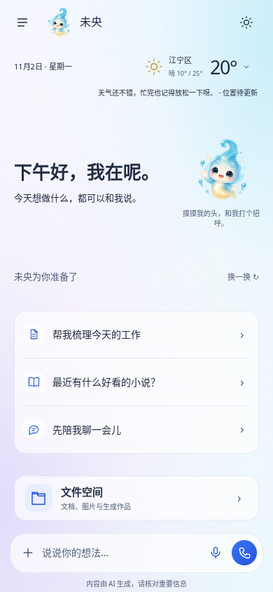

# 天气位置跟随与图库检测执行记录

日期：2026-11-02，北京时间。基于开发分支 `claude/jolly-darwin-tijh97` 的 `1ac30d4`；开始前和保存前均 fetch，远端无新增提交。用户要求修复手机换地点仍显示旧天气，并排查 Pixabay 已配置 Key 却不可用。

## 已定位的问题与修改

### 天气

- 原首页隔30分钟才考虑重新定位，且移动不足2公里跳过；安卓插件还能采用10分钟内的旧位置。原生回到前台的事件没有接入天气复查，所以换区后可能长期留在旧地点。
- 新增独立跟随调度模块，位置来源为“当前位置”时回到前台请求新定位，重复前台事件合并；前台每5分钟复查，后台暂停。手选城市保持固定，不因返回首页或刷新天气被覆盖。
- 新位置天气成功后再原子切换地点与温度；失败保留旧的一对数据，首页提示“位置待更新”，详情说明定位授权或取数未完成。迟到的定位/天气不能覆盖用户后来手选的城市或已销毁页面。同一粗坐标下新增区县名也更新，缺失区县不抹掉已知名称。
- 安卓请求支持最大缓存年龄；前台强制新定位，临时监听最多12秒，有新结果即释放。按单调时钟过滤旧定位，保留原粗略坐标与区县地理编码，不增后台/精确定位权限；暂停时取消。`maximumAge`从JSON原始Number解析，兼容JS整数0，避免Capacitor的Long读取丢掉0。

### Pixabay与其他图库

**程序问题已复现并修复；用户实际Key和服务器网络的失败原因仍待实测。**

- 原设置中输入新Key后直接点检测不会先保存，可能检测旧Key。现在只保存所点图库的Key再检测，不保存未提交的其他服务字段；Key不返回对话或错误信息。
- 每库显示缺Key、尚未检测、已启用及本次检测失败；保存不等于启用。原服务器国内检测门禁、API与图片真实下载均通过才启用的规则保留；前端不能直接写验证通过。
- 原先未验证、缺看图模型、API失败等常退成空结果，提示笼统。新增受控诊断，分别报告配置/API/图片下载/看图模型阶段；明确HTTP状态、无效Key标志、403拒绝、限流、DNS、TLS、超时及非JSON响应。不能把图片CDN的403或连接超时说成Key无效。
- 检测接口返回受控502与上游状态字段，上游401不会变成未央登录失效。仅读取最多4KB错误响应识别明确无效Key标志，原文、请求地址、Key均不返回。
- 配图无可用看图模型时明确说明，不随便用第一张图；真实模型筛图失败也明确区分。保留许可/可信域名/图片格式与大小/缓存/速率/取消边界。
- 公司/企业/团队识别为已有办公通用场景；配图检索带文档标题上下文。只有用户明确提到图库/Pixabay等时才追加图库故障说明，保留正常AI回退；禁止AI替代时回报真实图库原因。没有扩大图库支持到任意具体人物或新闻现场。
- 更新独立国内探测脚本中的来源适配器快照，旧脱敏测试继续有效。

## 已完成的本地验证

- `npm run lint`与变更模块额外ESLint：通过。
- 最终完整Vitest：341个文件，2,644项全部通过（首次候选为2,642项，最后并发补修新增2项），旧测试未删、未放宽。
- 网页、手机版、单文件三构建：通过。
- 最终新增天气跟随真实浏览器检查：20/20，包含无缓存首次取数与区县并发、不足2公里移动、原生/网页前台事件去重、手选城市、未授权不弹框、取数失败保留旧天气、迟到定位不覆盖手选；原16项全部保留。旧weather-seamless最终重跑：15/15。
- 新增天气单测11项、图库诊断与设置单测11项：包含HTTP/网络分类、API成功图片403、未验证仍禁止用库、缺看图模型不请求、敏感信息不回显、先保存再检测且不动天气Key，以及首次天气与区县补全并发。
- Android新增纯策略JUnit三项；本地没有JDK/Android SDK，未在本地编译，交由原发布门禁 `testReleaseUnitTest assembleRelease` 编译执行，须以CI结果为准。
- 新浏览器检查已接入发布工作流；完整smoke：174/174；单文件版standalone：14/14。二者依次执行，单文件版前已关闭本次网关；生成的根目录单文件HTML在测试后恢复，不纳入源码提交。CI结果在后续发布核验中记录。

截图使用固定模拟坐标、模拟天气响应；已实际查看画面，地点/温度及“位置待更新”可读，首页结构保留。**不是安卓真实GPS定位或和风真实接口验收。**





## 尚需用户环境核验

1. 真机更新后，允许系统定位并从A区移动到B区，回到前台看区县与天气是否更新；定位关闭时应显示待更新，可手动重新定位。手选城市应保持固定。
2. Pixabay实际Key没有提供给Codex，未在用户服务器实测，不能声称其Key或网络已恢复。可在服务器运行：

   ```bash
   node /opt/jarvis/current/evals/stock-images-live.mjs --provider=pixabay --network=cn
   ```

   只读保存的配置，测试API与图片下载，不调用模型、不改正式配置；只贴脱敏结果，不发Key。若安装目录不同应使用实际应用目录。脚本通过也只代表API/图片下载通过，不代表看图线路或整份PPT已通过真实模型验收；正式启用仍从设置点击检测。
3. 用户实际图库报错位置（设置检测/PPT取图）尚未回复。HTTP/phase/code能够缩小到Key、API网络、CDN或模型，不能仅凭“已配置”推断原因。
4. 未在用户服务器用真实模型制作PPT；原1.0.375美学、1.0.374含图自动配图和最终文件展示沿用完整回归保护。未代部署正式服务，未声称Claude已独立审查。

## 保存与发布核验

- 首个候选源码 `890610d`、独立清单 `ded0df6`（660文件）启动工作流#376 / `41391646835`。安卓原生 `:app:testReleaseUnitTest` 与 `:app:assembleRelease` 成功，Windows及发布前完整验证尚未全部结束时，由Codex主动取消，**没有正式发布376**。
- 取消原因：代码最终复核用无缓存、延迟首轮天气、先补同坐标区县名的场景复现 `status=loading, temp=null, refreshing=false`。元数据更新取消了同坐标正在取得的首轮天气。新增测试先红（11项中1失败），修复后同一文件11项全绿；另一测试确认不同坐标候选仍会取消、迟到结果不得覆盖新名称。
- 修复仅为当前请求记录目标坐标：补区县时保留同一坐标正在取的天气；其他坐标候选照常取消。新增真实浏览器无缓存并发场景，检查只发一次请求、区县名保留、温度显示与缓存写入。原16项浏览器断言保留，共20项。
- 最终版重新完成全量2,644项、代码检查、三构建及天气20/20与原无感刷新15/15。原smoke174/174、standalone14/14为首个候选本地结果，最终候选仍由完整CI重跑二者，不能借用旧结果冒称最终包通过。
- 正式版本、最终源码/清单与公开包核验完成后补记；所有保存提交均带 `[skip ci]`。

### 正式发布结果

- 最终源码 `9199721b102f62fea9ab9a6273f464862a65d5be`，独立运行时清单/发布标签提交 `c31e963479f155e478a79649454b16b038d7a645`，660文件。保存提交及清单提交均带 `[skip ci]`。
- 手动工作流#377 / `41393847366` 四项全部成功。北京时间2026-11-02 13:43:44正式发布 **1.0.377**；376已主动取消，没有发布。
- 最终CI重新通过341文件/2,644项完整单测、原生`:app:testReleaseUnitTest`和APK编译、三构建、六份PPT真实LibreOffice渲染、天气跟随20/20、原无感刷新15/15及其余原界面/服务器/架构/桌面门禁。CI最终smoke174/174、standalone14/14，未借用首个候选结果，也未放宽旧测试。
- 下载全部7份正式公开资产（约340MB）逐项核对官方SHA256；APK实际版本377/1.0.377、包名`com.xunova.jarvis`、与375证书一致、ZIP CRC正常。APK含新原生定位策略和天气/图库JS，原渐变/输入/历史/歌曲卡片/启动标记仍在。
- 服务器包659份源码逐项匹配660项固定清单，`package.json`的CI生成版本单独核对为1.0.377；包括天气跟随、图库诊断及原PPT图片美学三个模块。Windows安装版SHA512更新清单、服务器SHA256更新清单和免安装ZIP CRC均匹配。
- 公开版本：[desktop-v1.0.377](https://github.com/xunova1121/-/releases/tag/desktop-v1.0.377)。先更新云服务器，再更新手机/电脑，APK本身不会替换服务器代码。
- 用户真实手机GPS、Pixabay私有Key/国内网络及真实模型筛图仍未实测；没有用户服务器访问权限，也没有代部署正式服务。程序检测逻辑和诊断已修复，不等于用户当前Key已实测可用；待用户提供不含Key的实际报错。
