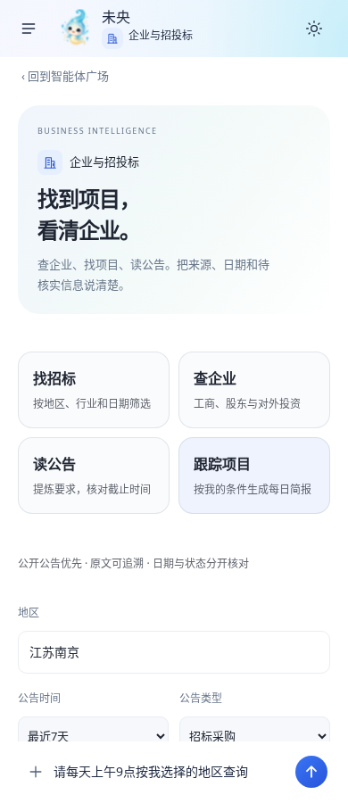
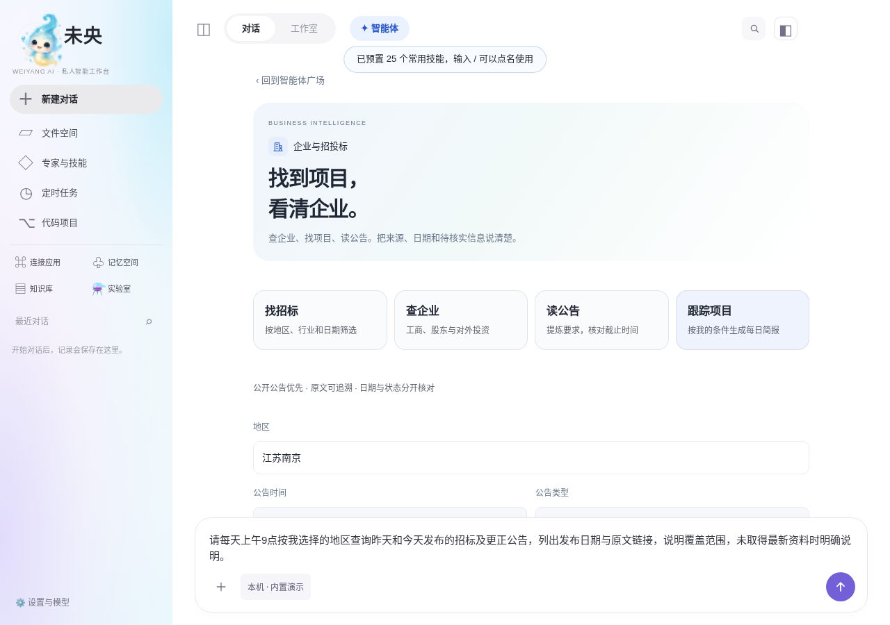

# 企业与招投标智能体执行记录（2026-11-11）

用户要求新增查企业、股东及对外投资、近期企业动态、招投标项目的智能体，优先免费来源；给出的参考是 ChinaDaaS-Department/qibook-skills。开发起点为 claude/jolly-darwin-tijh97 的 bdcd860，动手前已抓取并合并最新代码。

## 实现与使用

智能体广场新增「企业与招投标」，手机、桌面和网页沿用原入口、用户身份、会话、文件、定时任务与成果库。页面提供找招标、查企业、读公告、跟踪项目四个入口，点击只填草稿；用户提交后才执行。地区、日期、公告类别和数据来源保存在原智能体表单里。

- search_tenders：并行读取中国政府采购网、全国公共资源交易平台的公开最新公告，辅以原有搜索通道。支持地区/行业关键词、北京时间日期范围和招标、中标、更正、废标、意向分类。相同URL去重，但保留不同包件、后续更正与结果公告。
- read_tender_notice：读取原文并提炼项目编号、预算、最高限价、截止时间和要求。预算、最高限价和投资总额不互相替代；有报名时间但无投标截止时间时不推算。公共资源平台的 a 路径是导航入口，继续读取页面明确给出的同站同公告 b 路径正文，不执行脚本。只拿到导航不能称已读全文。
- lookup_company：默认检索公开政府/交易所资料，严格区分搜索摘要与原文。不会把汇款账户、第三方工程或借款案件中提到的银行，冒充该银行的工商股东资料。企业全称、信用代码、工商股东、上市公司股东、法人和实际控制人必须分别核对。
- 企百科可选：在模型设置的运行位置保存 API 地址与访问密钥。只有本轮用户明确选择企百科才调用，默认不调用。失败回退公开资料，返回HTTP/业务错误码，不把授权失败说成企业不存在。Key不入模型参数、日志或回执，服务器返回掩码；空值和掩码保存保留旧Key，不改jarvis.env。
- 跟踪复用原有定时任务：用户确认提交后才建立任务，可返回真实回执并管理。默认草稿查询昨天和今天的公告，不能声称已实现跨轮全网去重、增量数据订阅或完整监控覆盖。

旧8项内置编号及40/80题评测基线保留，实际目录扩展为9项。升级前个人智能体恰好使用新增ID时，仍优先读取、编辑原个人配置，不能让整个个人目录无法打开或接管旧会话。

普通聊天不额外携带这些Schema。回执最多8条、短摘要、总量12KiB有界，原文在按用户/会话隔离的证据库按编号回读。每次网络请求受检索预算、停止信号和超时限制；单一公告源失败不写全局搜索冷却。失败、部分来源失败、无匹配与日期待核实分开返回。

## 企百科参考核查

参考仓库：https://github.com/ChinaDaaS-Department/qibook-skills 。该命令能为支持 Skills 的宿主安装 qibook-company-profile；它本身不是未央三端现成插件，也不等于免费完整企业数据。

其说明要求 QIBOOK_ACCESS_KEY、QIBOOK_BASE_URL，接口为 /skill/entData/combinedQuery，使用 access_key 请求头。基本模块包含工商、股东、高管与对外投资，不能单靠这个技能完成最新招标搜索。原 Python 请求关闭证书校验，业务失败会返回空对象，存在把失败说成没查到的风险。本次依据公开接口约定独立实现JS适配，没有执行安装命令、引入Python或复制关闭TLS校验的行为。开源许可不等于第三方数据免费许可；没有账号，因此尚未验证企百科实际价格、权限和真实响应。

## 真实公开网络验证

地点是 Codex 开发环境，**不是用户服务器**。没有读取用户配置、访问密码或任何Key，没有调用真实收费模型。2026-11-11的HTML保存为测试夹具，可复核解析：

1. https://www.ccgp.gov.cn/cggg/ ：初次请求取得20条真实公告。后续生产publicFetch链路遇到403/超时，保留失败源，不能宣称持续可用。
2. https://www.ccgp.gov.cn/cggg/zygg/gkzb/202611/t20261111_27665071.htm ：「高性能工作站采购项目招标公告」，项目0722-26FE8015SZF-0，预算45.770000万元、最高限价45万元、投标截止2026年12月02日09点30分。修复“点/分”时间写法和截止字段误取章节标题。
3. https://www.ggzy.gov.cn/ ：取得24条公开交易/结果列表。实际 search_tenders 返回4条2026-11-11公告，包括武汉老泵站河、黄陂清淤勘察、云南天然橡胶、施甸光伏项目。列表截短标题有标记，不能伪装完整标题。
4. 老泵站河公告入口 https://www.ggzy.gov.cn/information/deal/html/a/420000/0101/20261111/004267fa09abe7d64bd29989c05e192ae8d7.html ：最初只取得导航，已修正继续读其公开b路径。真实正文有工程范围、资格预审和文件下载起止时间；没有明确投标截止值，保留未知。投资额24758.310000万元不冒充预算。首次导航误识别回执已作废，不计入最终验收。
5. 「江苏智慧农业」最近30天：实际仅取得待核实线索，未得到日期已核实的匹配项目；有来源503、DNS安全检查拒绝，不计通过。不得把天津项目里供应商所在江苏当成采购项目就在江苏，待核实线索也不能宣称地区已确认。
6. 「江苏银行」企业资料：收紧相关性过滤后本次搜索未完成；政府搜索无可用结果、巨潮域名在本环境被网络地址校验拒绝。未放宽SSRF检查，不计企业资料真实验收通过。

复核入口：jarvis/evals/business-public.mjs，默认只请求两个免费官方列表并尝试一份原文；--search 才加原有搜索引擎和企业用例。搜索引擎/模型若使用用户配置的收费服务，费用仍按其计费；“免费公开来源”不等于整个智能体运行零成本。

## 验证与交付状态

验证记录（不删测试、不增加超时、不放宽阈值）：

- lint通过；网页、mobile和standalone构建通过。最后补严企百科选用条件后，新增两套测试共39项通过并再次构建；提及、询价或明确拒用企百科都不算选择该来源。
- 全量Vitest最终运行404套/3181项：3180项通过，officeCheck中一项Excel公式修复在并行浏览器负载下超过原5000毫秒。停止其他负载后，原officeCheck套件26/26通过；新增最后一条凭据选择用例随上述39项定向通过。不能把这份记录描述成全量一次命令无重试全绿。
- 最终界面：business-intelligence 36/36，原agent-studio 170/170，原agent-square 171/171，共377项通过；覆盖320/390/412夜间/1280桌面和旧模块大字号。广场固定条数断言从8严格改为9，原8项仍检查。
- server-mode 15/15、standalone 14/14通过。均为临时测试数据、演示/夹具模型，不是用户服务器验收。
- smoke最终单独运行174/174通过。首次因开发环境未下载MediaPipe模型停在人脸检查，补齐官方模型后该项通过；和全量Vitest并行时HUD与WebGL恢复耗时失败，单独重跑全部通过，WebGL总计1306毫秒、应用35毫秒，保留原1500/300毫秒阈值。没有为环境缺件或争用改生产动画逻辑、删除断言或放宽测试。
- 新增解析、失败隔离、日期/地区/类别、公开正文、来源授权、凭据、预算、升级保护及服务器任务测试。HTML夹具只统一换行/缩进及去行末空白，不改网页正文与字段。

最终功能源码提交保留[skip ci]；没有触发Actions。根目录既有单文件发布产物不冒充此次新版本，新的本地构建位于jarvis/dist、dist-mobile、dist-standalone；安装包发布与用户服务器升级仍未执行。

未做：用户服务器实测、真实模型端到端回答质量、企百科真实凭据调用、Windows/Android真机验收、连续多日定时运行。未购买数据服务、未触发GitHub Actions、未上传新安装包、未修改用户服务器。源码接入和开发环境验证不等于已发版或用户服务器已更新。

## 界面预览

以下为最终构建的浏览器测试页面，不是用户服务器或真实模型结果。

