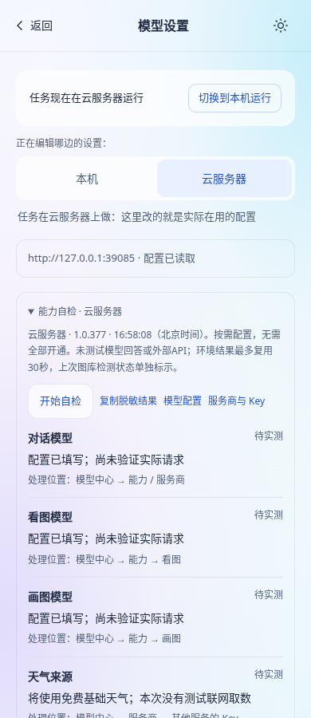
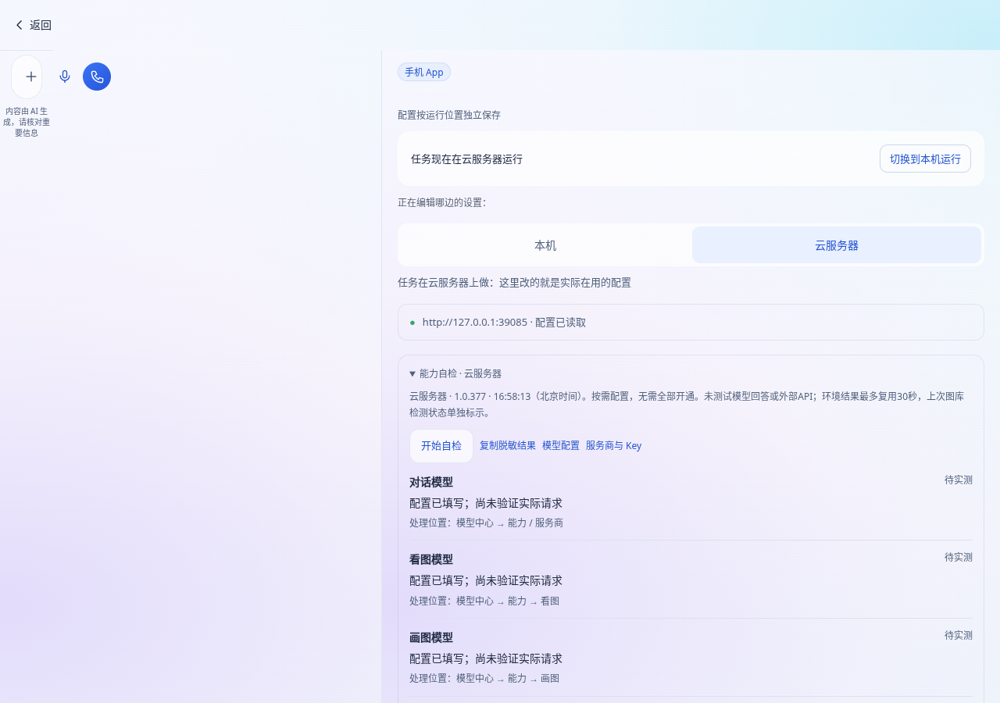

# 统一能力自检与重点真实复测

日期：2026-11-02（北京时间）。用户确认下一批先做统一能力自检和重点真实任务复测。开始前已fetch合并开发分支最新`b1592c6`，保存前再次fetch未见其他新提交；协调记录已登记共享文件接缝。

## 本批范围

- 在现有模型中心增加折叠的“能力自检”，本机/云服务器各检查各的配置与环境，不改变任务运行位置、默认模型或能力分工。
- 自检涵盖对话/看图/画图、天气、四家可选图库，以及Office、PDF截图、中文字体、ffmpeg、Git、代码测试/浏览器/技能容器。配置完整、上次连接通过、本次环境可用、缺失、未检查分别标示，没有“全填Key就算全通过”。
- 五类重点题：短聊天、体育资讯不要比分、六场上下文追问、Word修改、代码修错后同副本续做。每类默认两次，含追问的任务另跑第二轮。原30题、原6道速度质量补充题和评分标准不变；重点题不混入全量准确率。
- 不改任务并发、记忆策略、写作角色、持仓、架构/PPT布局或天气来源。不减少现有测试/发布门禁，不新增依赖。

## 自检实现与边界

共享报告由`shared/capabilityReadiness.js`构建，固定16项，只承载受控id/code/status/时间和版本；不装入配置、Key、URL、路径、原始进程输出或异常原文。模型/Key只做配置检查，未付费请求就标待实测；图库仅显示有效历史连接检测，不冒充当前制作或看图通过。

服务器`/api/server/readiness`必须登录。GET检查固定依赖及本地镜像；POST额外在代码镜像执行固定Node/npm/超时命令。检查容器不联网、不拉镜像、根目录只读、非root、无宿主挂载，并限制CPU/内存/进程与时间，结束后独立确认清理；不能确认即报不可用。镜像存在不代表可运行，BusyBox缺GNU超时命令、Node低于22和清理失败都不能算通过。浏览器/技能镜像本批仅inspect，明确标实际执行未验证。

本机通过已有网关的`/api/readiness`检查本机程序，云服务器模式不开放此本机入口。本机没有网关时保留模型配置结果，环境标未检查，不冒用服务器环境。固定环境检查每批最多三个子进程，两个模式各最多一份30秒缓存，并发请求合并，配置始终从当前配置重建，不缓存Key。

字体检查按实际中文字体清单判断；没有中文字体与没有字体检查程序分开报告。存在中文字体不等于具体文档没有回退或重叠，Office程序可运行也不等于文档渲染/视觉已通过。

界面切换位置或重绘会销毁旧请求，迟到结果不跨位置显示。停止只停止等待结果，服务器固定检查有上限并自行清理，不伪称取消已到达服务端的操作。复制再次经过相同白名单。修复入口可打开原模型/服务Key设置，其余依赖给出具体处理位置。可选服务按需配置，无需全部开通。

## 重点真实复测

`node evals/joint.mjs --focus`默认只列计划，不联网、不请求模型；显式`--live`才执行。重点模式与原30题补充模式不可混用，无效题号在提交前拒绝。旧30题无额外自检门槛，原运行前提保持。

重点模式先读当前服务版本/模型和空闲状态，再取得统一自检。旧服务器没有自检接口时停止并保存脱敏`预检失败.json`，不先请求模型。代码题仅使用连接好的`xunova1121/weiyang-code-sandbox`，代码容器兼容性未通过就记环境未就绪，不计通过，不要求模型冒险试错。

代码续做是基于原joint-28另列的新题，不改原题。结束后读取最多8MB的该任务工具事件，只有结构化的断网快照运行回执才算真实执行。核对同一个工作副本、红色测试→业务修改→绿色测试、源码指纹变化和追问保持、原lint/test重跑、退出码及测试统计；改测试/包/锁文件、换副本、仅说8/8、无证据或发生推送/合并不能通过。回执不保存源码和终端原文，完整回答和文件仍在私有报告里。

`evals/run-focus-server.sh 固定40位评测提交 [期望服务器版本]`在私有临时目录准备评测：复制evals/shared并解引用源符号链接，避免写回正式目录；其余已安装代码/依赖只读复用。先实际加载计划验证模块，再后台执行，正式源码、配置和服务不更新，测试仓库不推送。原30题执行器/评分/校准/文件读回复用，报告目录0700、文件0600；取不到价格/用量留未知，不估零。保持既有默认模型及能力分工，不擅自切换；实际调用型号逐次记录。

五类重点题只是小批。`focus-report.mjs`明确区分incomplete、blocked_readiness、failed、needs_review和automatic_review_passed；自动评审通过仍要求人工校准，不拿执行退出码0、文件名或“done”代替质量通过。

## 已完成的验证

- 新增19项单测，覆盖脱敏/范围/配置状态、镜像兼容及清理、并发缓存、真实HTTP鉴权与安卓跨域、重点题独立性、预检零任务提交、红绿证据及失败反例、待评审/缺环境不算通过，以及用户后续红线要求的新入口不读访问密码。
- 本地完整344个文件/2,662项通过。原serverMode公网example.com项首轮未走环境代理超时；按已有约定使用`NODE_USE_ENV_PROXY=1`原测试复查通过，未改时限/断言。
- 字体无字库与无程序的原因补分后，三文件18项专项重跑通过；新增不读密码启动器规则后focusEval八项通过，最终CI将重跑344文件/2663项。字体分类以固定异常场景验证，不冒称已在用户服务器检测过。
- 新浏览器检查接入原发布工作流，最终27/27（含真实脱敏复制）。实际手机构建+真实鉴权路由，云端依赖为固定替身、本机依赖为实际检查，不请求真实模型或图库公网API。已实际查看页面，无横向溢出，原渐变/设置导航保留。
- 代码检查、额外模块ESLint、三构建、原smoke174/174、standalone14/14均通过。生成的根目录单文件HTML已在测试后恢复，不提交打包产物。

截图来自实际手机版构建和真实鉴权接口，环境状态及版本数字为夹具，不是用户服务器检测结果。

## 尚未完成的真实验收

没有用户服务器访问凭据，本批真实模型还未启动，不能给准确率或提速比例。发版后需更新服务器和客户端，再在用户服务器显式启动重点复测，回传私有包核对原回答、文件、真实用时和人工校准。此脚本会调用模型并消耗现有额度；无需把密码或Key发给Codex。真实安卓/Windows安装、用户服务器依赖及Docker兼容、Pixabay连接仍以实际运行结果为准。

Claude独立互审尚无回执，不冒称完成；已把接缝与边界写在协调记录。所有保存及独立运行时清单提交带`[skip ci]`，最终门禁及公开包核验完成后补记正式版本。

## 用户追加的顺序与安全红线

用户随后明确先发布本批，再按新交接完成访问安全、评测专用令牌、百度千帆搜索。已fetch并合入Claude新文档提交`fefe13b`，仅新增交接文档，不影响已测业务代码。

新重点启动器不读取访问密码或`jarvis.env`，不调用旧密码启动脚本；只从私有环境取得评测授权，缺授权就在模型请求前停止。按用户新顺序，真实复测暂缓，待下一批专用令牌方案完成后再在用户服务器显式启动。只执行重点任务并保存回答/文件，不自动运行旧评审入口；模型评分和人工校准仍标待执行。未生成、读取或输出用户实际令牌，不将这段新增入口当作专用令牌后端已经实现。
